- [EEMs-toolkit - 0.2.0](#eems-toolkit---020)
  - [开发环境](#开发环境)
  - [安装EEMs-toolkit](#安装eems-toolkit)
  - [功能简介](#功能简介)
    - [1. 数据导入](#1-数据导入)
    - [2. 预处理](#2-预处理)
      - [2.1 内滤效应校正](#21-内滤效应校正)
      - [2.2 扣除空白](#22-扣除空白)
      - [2.3 拉曼单位化](#23-拉曼单位化)
      - [2.4 去除不需要的波长部分](#24-去除不需要的波长部分)
      - [2.5 稀释因子校正](#25-稀释因子校正)
      - [2.6 去除瑞丽（Rayleigh）散射和拉曼（Raman）散射](#26-去除瑞丽rayleigh散射和拉曼raman散射)
      - [2.7 缺失值插值](#27-缺失值插值)
      - [（可选）荧光矩阵平滑（高斯核）](#可选荧光矩阵平滑高斯核)
    - [3. PARAFAC分析](#3-parafac分析)
    - [4. 结果](#4-结果)
    - [5. 其他功能](#5-其他功能)
  - [测试示例](#测试示例)
  - [Releases 中应用程序教程](#releases-中应用程序教程)
  - [引用 Cite](#引用-cite)
  - [Star History](#star-history)


# EEMs-toolkit - 0.2.0

EEMs-toolkit是一个可以在Python上对三维荧光（EEM）进行平行因子分析（PARAFAC）的工具包，功能大致类似于MATLAB的drEEM toolbox。


## 开发环境

Windows 10，Python 3.11.7，采用的额外的包及版本见下表：

|     包     |  版本  |
| :--------: | :----: |
|   numpy    | 2.4.6  |
|   pandas   | 3.1.1  |
| matplotlib | 3.11.2 |
|   scipy    | 1.17.1 |
|  tensorly  | 0.10.0 |
|   tlviz    | 0.1.1  |
|   xlrd     | 2.0.2  |
|  openpyxl  | 3.1.5  |

------
## 安装EEMs-toolkit
```python
pip install EEMs-toolkit
```


## 功能简介

### 1. 数据导入

   - 样本导入
   - 空白导入
   - 紫外光谱导入

### 2. 预处理

#### 2.1 内滤效应校正

原始数据

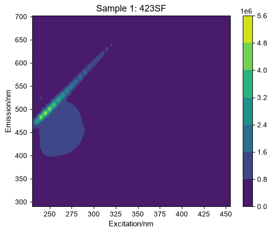


校正后

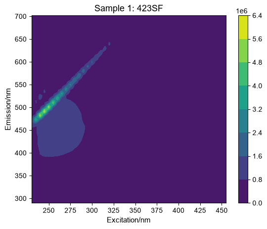

#### 2.2 扣除空白


#### 2.3 拉曼单位化

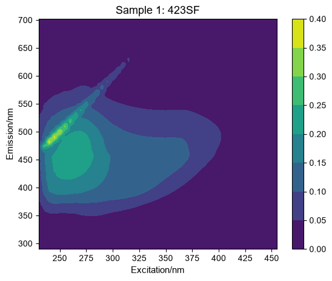

#### 2.4 去除不需要的波长部分

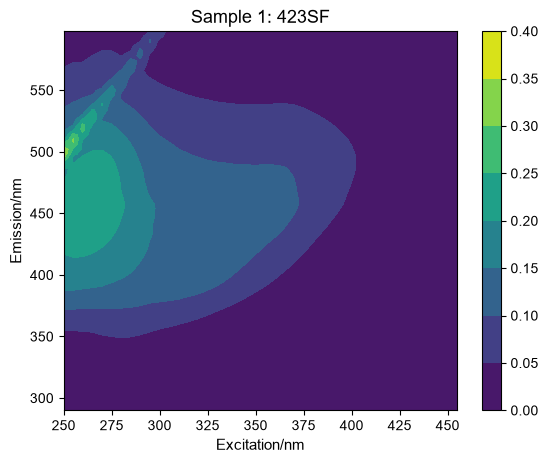

#### 2.5 稀释因子校正


#### 2.6 去除瑞丽（Rayleigh）散射和拉曼（Raman）散射

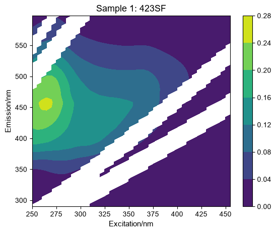

#### 2.7 缺失值插值

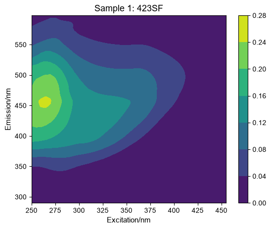

#### （可选）荧光矩阵平滑（高斯核）


### 3. PARAFAC分析

- 采用非负约束计算不同组分数的模型
- 绘制异常样本测试图

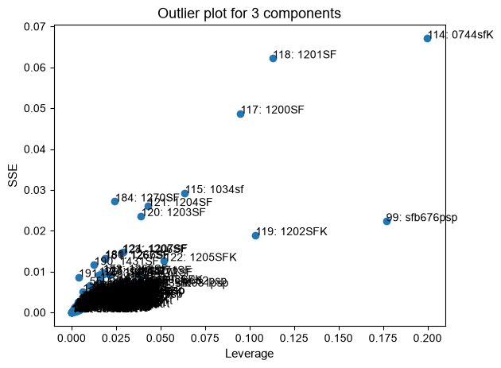

- 去除异常样本
- 重新计算模型，再次绘制异常样本测试图
- 观察残差、核一致性……

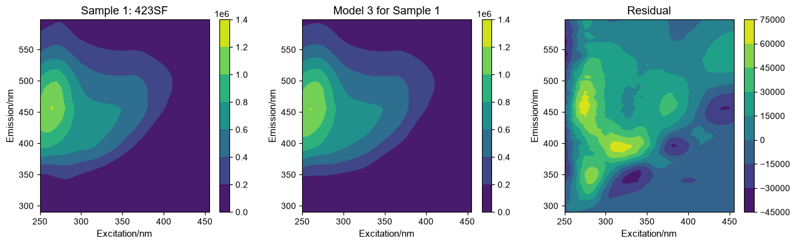
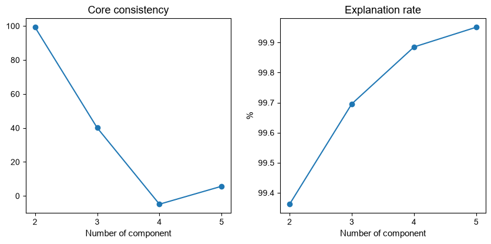

- 运行分半分析（S4C6T3）
- 分半检验

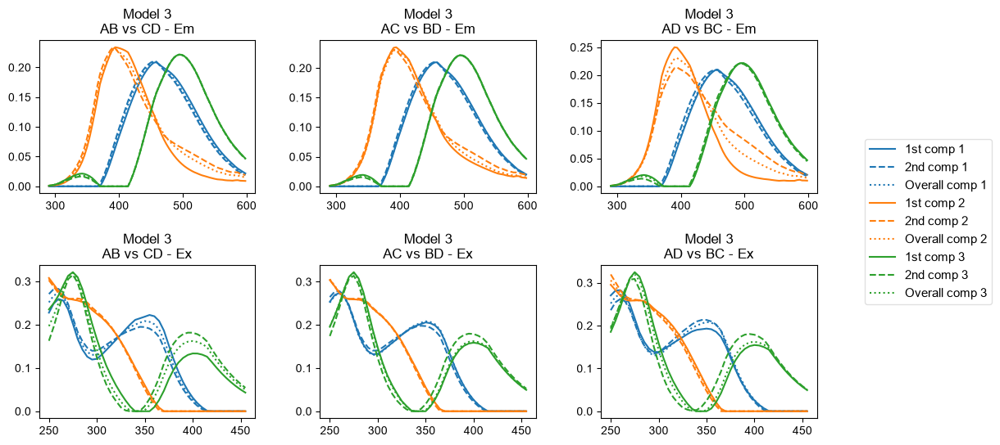

- 确认组分数


### 4. 结果


- 组分图绘制

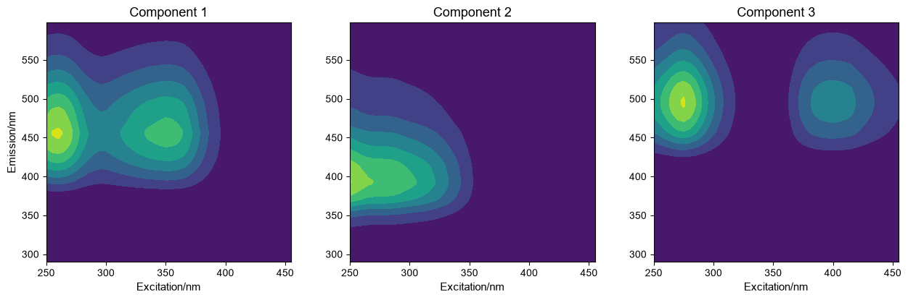

- 载荷图绘制

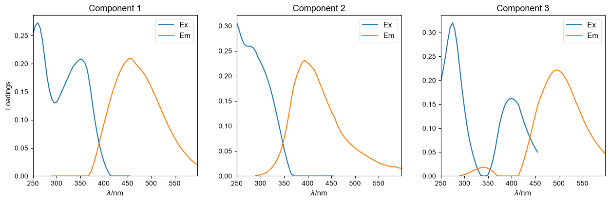

- 模型结果导出，包括FMax，Em loadings，Ex loadings，组分图数据

### 5. 其他功能

   - 预处理后样本数据导出

   - OpenFluor文件导出，可上传对比数据库

   - 区域积分（FRI）计算，结果导出
   - 荧光指数（Fluorescence index、Freshness index、Humification index，Biological index）计算，结果导出
   - 光谱斜率SR计算，结果导出

------


## 测试示例

见 `demo1.ipynb`
   
## Releases 中应用程序教程
   [EEMs-toolkit GUI 视频教程](https://zhuanlan.zhihu.com/p/605396414)

## 引用 Cite
   Machine Learning-Assisted Source Tracing in Domestic-Industrial Wastewater: A Fluorescence Information-Based Approach  
   DOI: 10.1016/j.watres.2024.122618
   
## Star History

[](https://star-history.com/#HHhyJJ/EEMs-toolkit&Date)


