[English](README.md) | [中文文档](README.zh-CN.md)

# EEMs-toolkit - 0.3.0

EEMs-toolkit 是一个可以在 Python 上对三维荧光（EEM）进行平行因子分析（PARAFAC）的工具包，
功能大致类似于 MATLAB 的 drEEM toolbox。

既可以在 notebook / 脚本中使用（matplotlib 绘图），也可以安装可选的本地 Web 界面
（Plotly.js 绘图，中英文界面切换）。

API 参考文档（由源码自动生成）：[中文](docs/API.zh-CN.md) / [English](docs/API.md)

## 功能简介

- **数据导入**：EEM 样本、紫外吸光度、空白样本与 SampleLog。
- **预处理**：内滤效应校正、扣除空白、拉曼单位化（AU → RU）、样本/波长裁剪、稀释校正、
  去除瑞利/拉曼散射、缺失值插值（Delaunay）、可选高斯平滑。
- **PARAFAC**：非负约束、多组分数、多次随机起始、核一致性与解释率、残差、
  SSE 分析（不同组分数对比，并可按样本 / 发射波长 / 激发波长聚合）、Leverage–SSE 异常样本诊断、
  剔除异常样本、分半分析与验证（S4C6T3）。
- **结果**：FMax、Ex/Em 载荷、组分 fingerprint 图、OpenFluor 文本与 Excel 导出。
- **其他分析**：荧光指数（FLUI、FREI、HIX、BIX）、区域积分（FRI，五个区域）、
  吸收光谱斜率与 SR。
- **项目**：将整个会话（数据、预处理历史、模型）保存为 `.eemproj`，之后可重新载入。

## 安装 EEMs-toolkit

```bash
pip install EEMs-toolkit
```

## Web 界面（可选）

```bash
pip install "EEMs-toolkit[web]"
eems-web                 # 默认 http://127.0.0.1:8000
eems-web --port 8080     # 指定端口
eems-web --no-browser    # 不自动打开浏览器
```

Web 版覆盖完整流程：数据导入 → 预处理（实时预览、上一步对比、任意历史状态回退）→
PARAFAC（后台运行，可随时停止）→ 分半分析 → 荧光指数 / FRI / 吸收斜率 → 导出 → 项目保存与读取。

- **中英文界面**：右上角选择器切换 中文 / English，选择会保存在浏览器中；
  首次打开按浏览器语言自动选择。Element Plus 控件（弹窗、按钮等）同步切换。
- **图表**：使用 Plotly.js。EEM 以“等高线 + 等高线间填充”的 contour 图绘制（不平滑），
  等高线数量可手动设定（0 = 自动）；预处理页提供 3D 曲面视图。
- 所有图表支持导出 PNG / JPEG / SVG；位图分辨率以具体像素尺寸选择（如 844 × 784）。
  图例默认显示，并可通过每张图上的“图例”开关手动开启或关闭。
- FRI 图横轴为 Em、纵轴为 Ex，并绘制五个区域与 Ⅰ–Ⅴ 标注。
- 历史时间线支持回退到任意步骤，也支持删除某一步及其之后的所有步骤。
- 内滤效应校正、扣除空白、拉曼单位化只能执行一次，前端按钮与后端接口都会拦截重复执行；
  如需重做请先在历史时间线回退。
- 插值后仍存在的缺失值会给出提示，PARAFAC 计算时按 0 处理。
- 导入页提供示例压缩包（`eem/`、`abs/`、`blank/`、`SampleLog.xlsx`），可直接上传体验完整流程。
- 默认仅监听本机 `127.0.0.1`，无用户体系，适合单机使用。

### 页面导航

1. **数据导入**：上传文件夹/文件或 zip 压缩包，也可载入已有项目。
2. **预处理**：全部校正步骤，带实时预览与历史时间线。
3. **PARAFAC 分析**：3.1 建模、3.2 异常值识别、3.3 分半验证、3.4 结果与导出，分别独立路由。
4. **指数 / FRI / 斜率**：结果表格、图形展示与 Excel 下载。
5. **项目保存与导出**：保存/载入 `.eemproj` 项目，勾选并下载所需结果。

### 从源码构建前端（仅开发时需要）

```bash
cd frontend
npm install
npm run build
```

产物生成到 `src/EEMs_toolkit/web/static/`，并打入 wheel；缺少该目录时 `eems-web` 会给出提示。

## 开发环境

Windows 10，Python 3.11.7，主要依赖版本：

|      包     |   版本   |
| :--------: | :----: |
|    numpy   |  2.4.6 |
|   pandas   |  3.1.1 |
| matplotlib | 3.11.2 |
|    scipy   | 1.17.1 |
|  tensorly  | 0.10.0 |
|    xlrd    |  2.0.2 |
|  openpyxl  |  3.1.5 |

Web 前端：Vue 3、TypeScript、Element Plus、Plotly.js、vue-i18n。

## 预处理效果示例

### 内滤效应校正

原始数据

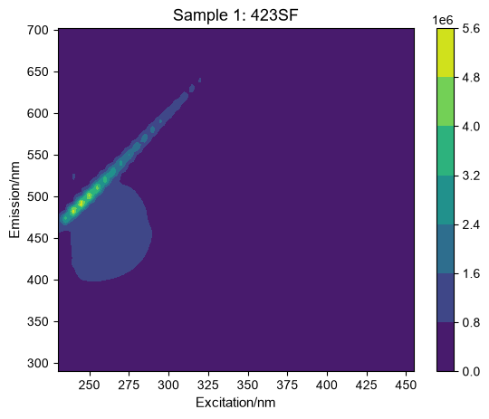

校正后

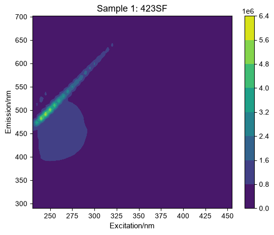

### 扣除空白


### 拉曼单位化

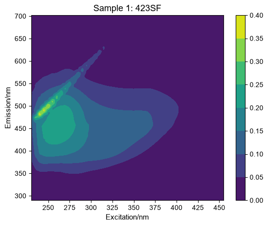

### 去除不需要的波长部分

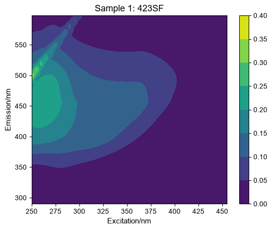

### 稀释因子校正


### 去除瑞丽（Rayleigh）散射和拉曼（Raman）散射

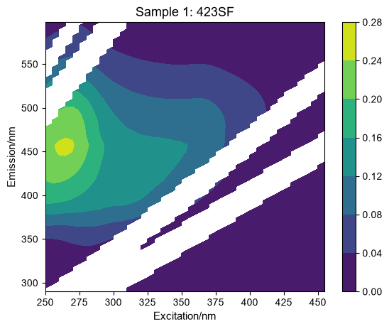

### 缺失值插值

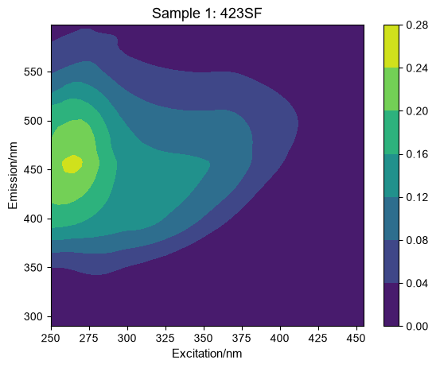

### （可选）荧光矩阵平滑（高斯核）


## PARAFAC 分析示例

- 采用非负约束计算不同组分数的模型
- 绘制异常样本测试图

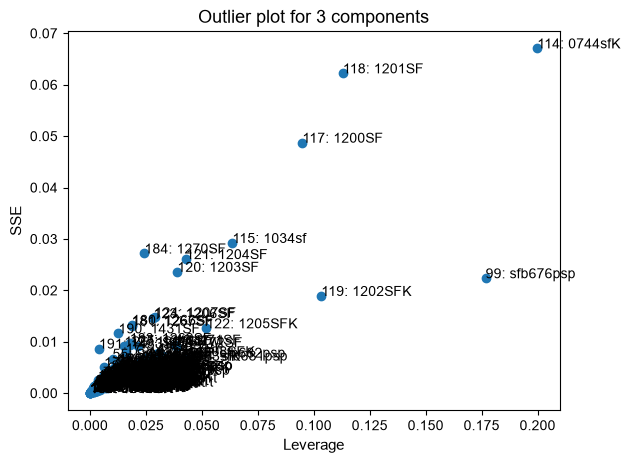

- 去除异常样本后重新计算模型，观察残差、核一致性……

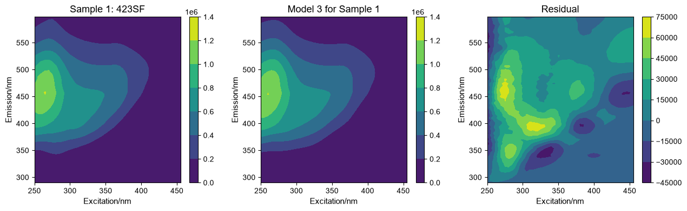
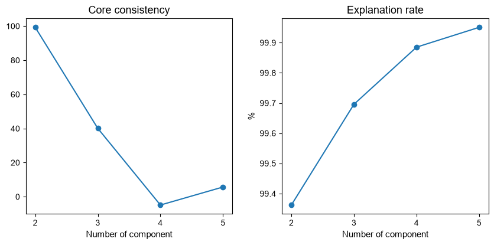

- 运行分半分析（S4C6T3）并检验

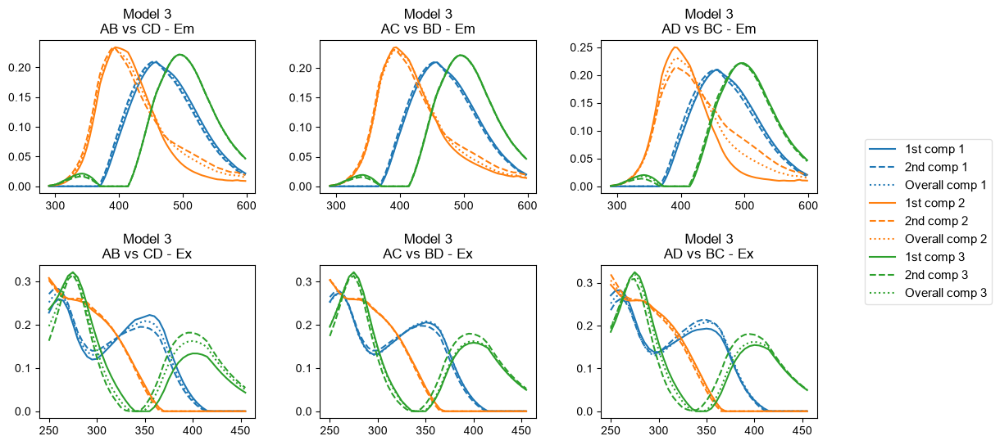

- 确认组分数，绘制组分图与载荷图

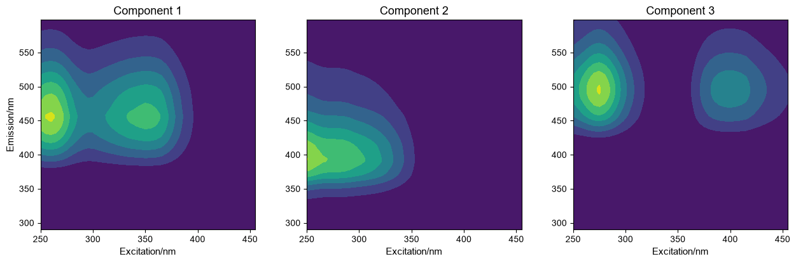
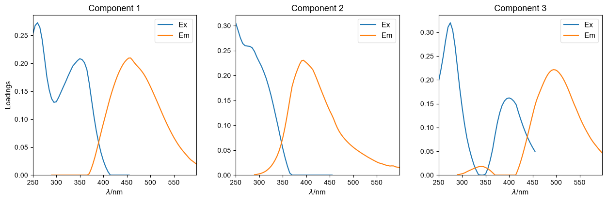

## 测试示例

见 `demo1.ipynb` 与 `Example/` 目录（`Example/demo.xlsx` 含 14 个样本）。

## Releases 中应用程序教程

[EEMs-toolkit GUI 视频教程](https://zhuanlan.zhihu.com/p/605396414)

## 引用 Cite

Machine Learning-Assisted Source Tracing in Domestic-Industrial Wastewater: A Fluorescence
Information-Based Approach
DOI: 10.1016/j.watres.2024.122618

## Star History

[](https://star-history.com/#HHhyJJ/EEMs-toolkit\&Date)
